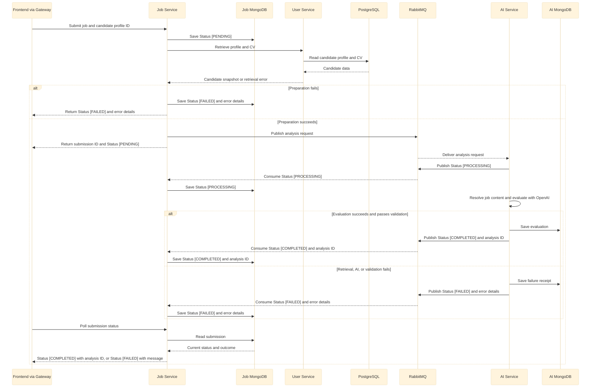

# JobKaki Backend

## LLD Architecture

> **Figma link coming soon.** Backend low-level design covering service layers and component interactions.

<!-- Replace this placeholder with the backend LLD Figma link. -->

## Job Analysis Processing




## Service Responsibilities and Data Ownership

| Service                        | Default port | Responsibility                                                                                  |
| ------------------------------ | ------------ | ----------------------------------------------------------------------------------------------- |
| API Gateway (`gateway`)        | 8080         | Authenticate browser API traffic, route requests through discovery, and synchronize local users |
| User Service (`userservice`)   | 8081         | Manage local users, onboarding state, candidate profiles, and original CV files                 |
| Job Service (`jobservice`)     | 8082         | Own submissions and statuses; assemble candidate/CV snapshots and publish analysis requests     |
| AI Service (`aiservice`)       | 8083         | Resolve job content, call the provider, validate results, and serve saved evaluations           |
| Config Server (`configserver`) | 8888         | Serve configuration from its `classpath:/config` native repository                              |
| Eureka (`eureka`)              | 8761         | Register application services for gateway discovery                                             |

Keycloak runs separately on port 8084 in the local launcher. PostgreSQL, MongoDB, and RabbitMQ are infrastructure dependencies, not application services.

| Owner        | Store                | Data                                                                                                                  |
| ------------ | -------------------- | --------------------------------------------------------------------------------------------------------------------- |
| User Service | PostgreSQL           | Users, onboarding completion, candidate contexts, preference collections, and CV bytes in `bytea`                     |
| Job Service  | MongoDB job database | `job_submissions`: original job input, selected profile ID, lifecycle status, analysis ID, and public failure details |
| AI Service   | MongoDB AI database  | `job_analyses`: completed evaluations; `job_analysis_failures`: failure receipts keyed by submission ID               |

- Each service accesses only its own database.
- Local development can share one MongoDB server, with separate databases for Job Service and AI Service.

## Setup and Running Locally

The steps below describe how I run JobKaki locally. Secrets are stored in local `.env` files, which are excluded from Git and are not included in this repository.

### Prerequisites

- Java 20
- Docker
- Node.js and npm
- `curl`

Use the checked-in Maven Wrappers; a separate Maven installation is not required.

### 1. Start external dependencies

Ensure the following are running before starting the backend:

- **Keycloak and RabbitMQ:** Run through Docker.
- **PostgreSQL and MongoDB:** Run locally or through Docker.

### 2. Start the backend services

The services are located under `Backend/`:

| Group | Service directories |
|---|---|
| Configuration and discovery | `configserver/`, `eureka/` |
| API Gateway | `gateway/` |
| Application services | `userservice/`, `jobservice/`, `aiservice/` |

Open a separate terminal for each service and run the following command from its directory:

```sh
./mvnw spring-boot:run
```

Start Config Server and Eureka first. Once both are ready, start the gateway and application services.

### 3. Start the frontend

From the repository root:

```sh
cd Frontend
npm install
npm run dev
```

Open the local URL printed by Vite.

| File                   | Configuration                                                                                                                                                                                              |
| ---------------------- | ---------------------------------------------------------------------------------------------------------------------------------------------------------------------------------------------------------- |
| All four service files | `CONFIG_SERVER_URL=http://localhost:8888`, `EUREKA_SERVER_URL=http://localhost:8761/eureka/`                                                                                                               |
| `gateway/.env`         | `KEYCLOAK_ISSUER_URI=http://localhost:8084/realms/jobkaki-oauth2`, `CORS_ALLOWED_ORIGINS=http://localhost:5173`                                                                                            |
| `userservice/.env`     | `DATABASE_URL=jdbc:postgresql://localhost:5432/jobkaki_user_db`, `DATABASE_USERNAME`, `DATABASE_PASSWORD`                                                                                                  |
| `jobservice/.env`      | `MONGODB_JOB_URI=mongodb://localhost:27017/jobkaki_jobs`, `MONGODB_JOB_DATABASE=jobkaki_jobs`, `USER_SERVICE_BASE_URL=http://localhost:8081`, plus RabbitMQ values below                                   |
| `aiservice/.env`       | `MONGODB_AI_URI=mongodb://localhost:27017/jobkaki_ai`, `MONGODB_AI_DATABASE=jobkaki_ai`, `OPENAI_API_KEY`, `OPENAI_API_BASE_URL=https://api.openai.com/v1`, `OPENAI_API_MODEL`, plus RabbitMQ values below |

Set these RabbitMQ values identically in Job Service and AI Service. They are an example local topology; names are configurable through Config Server.

```dotenv
RABBITMQ_HOST=localhost
RABBITMQ_PORT=5672
RABBITMQ_USERNAME=guest
RABBITMQ_PASSWORD=guest
RABBITMQ_EXCHANGE_NAME=jobkaki.exchange
RABBITMQ_ANALYSIS_QUEUE_NAME=jobkaki.analysis
RABBITMQ_STATUS_QUEUE_NAME=jobkaki.status
RABBITMQ_ANALYSIS_ROUTING_KEY=job.analysis
RABBITMQ_STATUS_ROUTING_KEY=job.status
```

`OPENAI_API_MODEL` must support the document-input and structured-output request used by `OpenAIService`. Do not place the provider key in frontend configuration. The broker must accept messages up to the application's 8 MiB limit.

