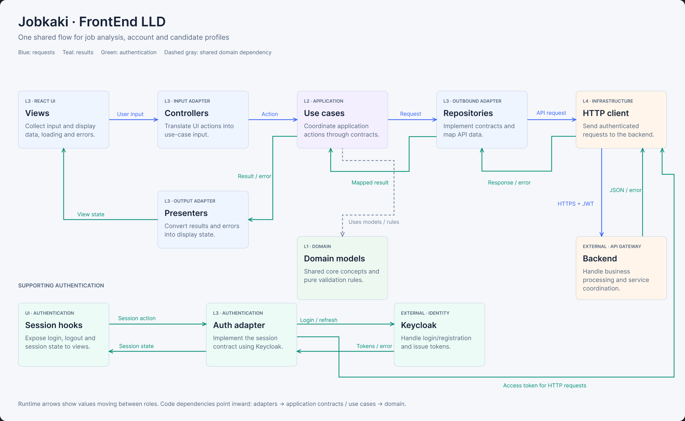
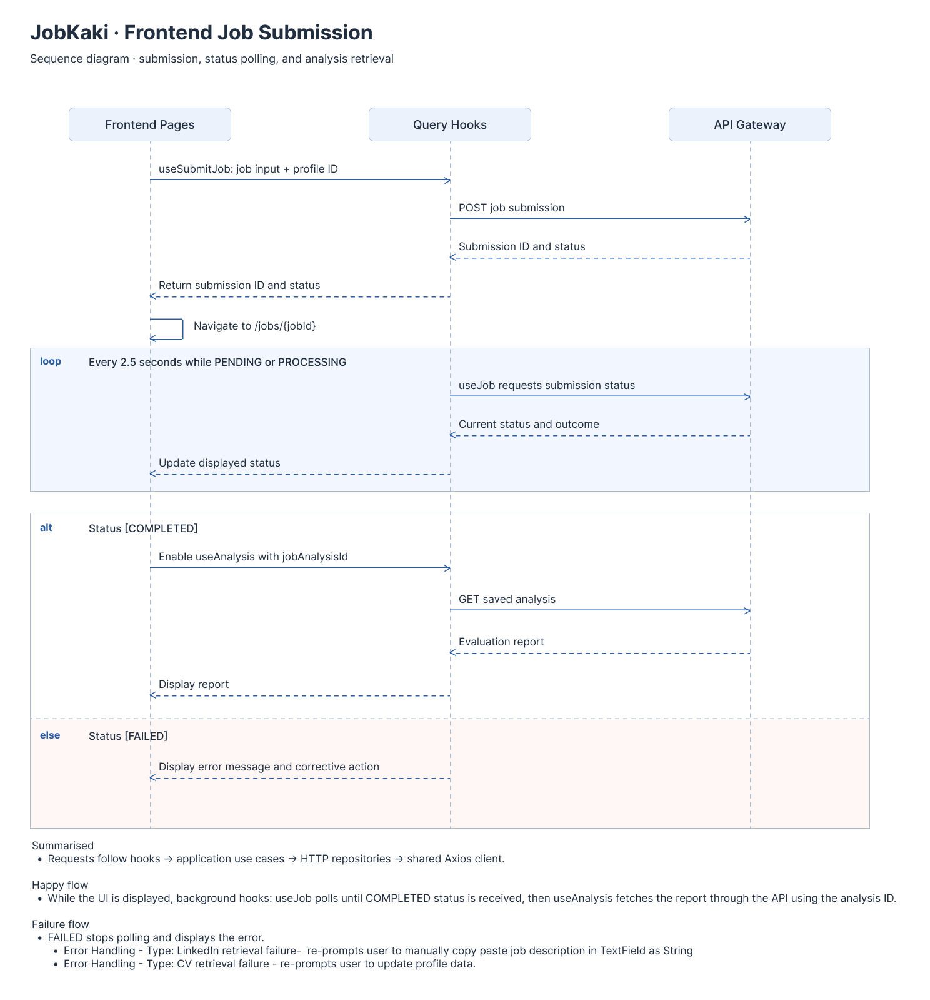

# JobKaki Frontend

## LLD Architecture



[View the LLD in Figma](https://www.figma.com/design/TlqNS7H8eS6y3poiiImCV9/Java-System-Architecture?node-id=339-170)

This proposed design shows one shared flow for job analysis, accounts, and candidate profiles. Requests pass from views through controllers, use cases, repositories, and the HTTP client to the backend. Results return through presenters as view state; authentication is shown as a supporting flow.

The arrows show runtime flow. Source-code dependencies point inward toward application contracts and domain models.

### Current Implementation

The frontend uses one application-wide Clean Architecture, organised by layer rather than feature.

| Layer                   | Directory            | Responsibility                                                                   |
| ----------------------- | -------------------- | -------------------------------------------------------------------------------- |
| 1. Entities             | `src/domain`         | Frontend-owned business models and rules                                         |
| 2. Use Cases            | `src/application`    | Application operations and the contracts they require                            |
| 3. Interface Adapters   | `src/adapters`       | Controllers, presenters, React views, repositories, and external service clients |
| 4. Frameworks & Drivers | `src/infrastructure` | Axios transport, Keycloak SDK construction, and environment configuration        |

[`src/app/dependencies.ts`](src/app/dependencies.ts) is the composition root. It creates the HTTP transport and authentication client, injects them into adapters, and binds repositories to the application use cases using [`src/app/createApplication.ts`](src/app/createApplication.ts). Views depend on `application/contracts/ApplicationContract.ts`, keeping startup wiring outside the application layer. `main.tsx` passes the constructed dependencies to [`AppContainerProvider`](src/infrastructure/providers/AppContainerProvider.tsx), which assembles the React provider tree. [`createQueryClient`](src/infrastructure/clients/createQueryClient.ts) owns React Query configuration; adapter containers expose injected dependencies and reactive state.

```text
src/
├── domain/models/
├── application/
│   ├── contracts/
│   │   ├── ApplicationContract.ts
│   │   ├── controllers/
│   │   ├── repositories/
│   │   ├── clients/
│   │   └── presenters/
│   └── use-cases/
├── adapters/                           # Layer 3: Adapt application input/output to external systems and UI
│   ├── controllers/                    # Validate/translate incoming input and invoke use cases
│   ├── hooks/                          # Connect React to operations, forms, request state, caching, and subscriptions
│   ├── containers/                     # Define shared dependency/state access points
│   ├── presenters/                     # Convert application outcomes into display-ready output
│   ├── repositories/                   # Implement repository contracts through backend data access
│   ├── clients/                        # Implement client contracts and translate external service behavior/data
│   └── views/                          # Render state and forward user interactions
│       ├── routes/                     # Map URLs to pages and apply navigation/access guards
│       ├── pages/                      # Compose page layouts from components and bind state/events
│       ├── components/                 # House reusable visual building blocks
│       │   ├── primitives/             # Provide foundational controls and surfaces
│       │   └── composed/               # Combine primitives into reusable interface elements and layouts
│       ├── utils/                      # Provide small display and browser interaction helpers
│       └── styles/                     # Define visual tokens, global styles, and component styling
├── infrastructure/                     # Layer 4: Configure frameworks, tools, and runtime wiring
│   ├── keycloak/                           # Construct and configure the authentication SDK
│   ├── clients/                        # Construct and configure Axios transport and TanStack Query clients
│   │   ├── createHttpClient.ts
│   │   └── createQueryClient.ts
│   ├── providers/                      # Supply container values and assemble the React provider tree
│   └── config/                         # Read and validate environment configuration
├── app/
│   ├── App.tsx
│   ├── createApplication.ts
│   └── dependencies.ts
└── main.tsx
```

Containers use React Context internally; the `Container` suffix is our project naming convention. Consumers read containers directly with `useContext` and check that a provider supplied the dependency or state. Infrastructure providers supply values; containers do not construct dependencies.

### Dependency boundaries

- `useProfileEditor` and `useProfiles` live in `adapters/hooks/useContexts.ts`. Controllers validate and translate profile input; candidate-context use cases invoke the presenter for card labels and editable multiline values. Hooks own form synchronization, file reading, mutations, and navigation. Existing list/detail cache keys and mutation invalidation are preserved.
- `useOnboardingForm` in `adapters/hooks/useOnboardingStatus.ts` handles wizard state and browser file reading. `OnboardingController` translates input; `finishOnboarding` creates the initial context before completing the account. A plain progress contract retains the created context ID across completion retries within the mounted attempt; it is not persisted across reloads.
- `useLogin` in `adapters/hooks/useAuthSession.ts` exposes shared authentication state and a login mutation that reports failures to the sign-in page.
- `useJobHistory` in `adapters/hooks/useJobs.ts` owns local history search and confirmed deletion. `useJobResult` coordinates submission polling, completed-report retrieval, confirmation, and navigation after successful deletion. Both pages render query state and forward events. `JobPresenter` prepares history previews, submission labels/dates/links, and report detail rows. Deletion uses mutation callbacks so request failures remain query errors without unhandled event-handler rejections.
- Dashboard primary-context output follows `usePrimaryContext` → `CandidateContextController` → `getPrimaryCandidateContext` → `CandidateContextPresenterContract`. The first context in repository order is primary; an empty list invokes the empty presenter outcome. The presenter prepares labels, dates, and links. `usePrimaryContext` observes the same `["contexts", userId]` raw-list cache as other context hooks and invokes selection/presentation through the controller in React Query’s `select` callback. Prepared output belongs to that query observer; the shared cache retains raw contexts so consumers and mutations keep sharing it. Request failures remain query errors.
- Provider assembly and remaining wrappers belong in `infrastructure/providers`, with query client construction/defaults in `infrastructure/clients/createQueryClient.ts`. Adapter-owned containers expose injected dependencies without importing infrastructure. `adapters/hooks/useAuthSession.ts` handles session subscriptions and React state adaptation; `AuthContainerProvider` supplies that state through context.
- Domain code imports only domain code. Application code imports only application/domain code. Neither imports React, React Query, Axios, or Keycloak.
- `adapters/hooks/useJobs.ts` exports job query/mutation hooks alongside `useAnalyseJobForm`, which owns submission form setup, adapts controller validation to React Hook Form, reads URL defaults, switches submission mode, and navigates after a successful submission. `AnalyseJobPage` binds its returned form state and event handlers.
- `adapters/hooks/useAccount.ts` exports `useAccount`, `useSaveAccount`, and `useAccountForm`. `useAccountForm` owns account form setup, adapts controller validation to React Hook Form, synchronizes loaded account values, and submits through the existing account mutation. `AccountPage` binds the returned form and renders query/mutation feedback. Refreshed account data continues to reset form values.
- Account and job views and hooks use injected `AccountControllerContract` and `JobControllerContract` implementations. Profile hooks use `CandidateContextControllerContract`, onboarding workflow hooks use `OnboardingControllerContract`, and account completion uses `AccountControllerContract`. Views do not construct controllers or import concrete repositories, external clients, or the composition root. Query caching, polling, and invalidation stay in React hooks.
- `AccountController` implements the layer 2 `AccountControllerContract`, validates account input with a private Zod schema, and invokes the injected application account API. Validation results expose plain field messages, so account views depend only on the contract. Startup wiring constructs the controller and supplies it directly through `AccountControllerContainer.Provider` in `AppContainerProvider`. `JobController` implements `JobControllerContract`, privately validates and trims submission input, and invokes the job and analysis application API. `JobControllerContainer.Provider` supplies it to job views and hooks; polling, cache invalidation, and navigation remain in React. Presenters prepare display data. React components are the views. Controller/presenter modules are extracted when they have meaningful responsibilities.
- View components have two groups: `components/primitives` contains foundational controls and surfaces; `components/composed` contains reusable combinations, feedback, application framing, and application-aware building blocks. Composed components may use primitives; primitives remain independent of application workflows.
- Job and analysis use cases invoke the layer 2 `JobPresenterContract` for successful results and request failures. The concrete `JobPresenter` formats processing messages, report text, and recovery actions, and its display-output types are colocated in `JobPresenter.ts`.
- Presenter output flows back through the controller into React Query's cache. React Query owns request loading, errors, retries, and polling; views render the cached output without invoking the presenter or maintaining a second copy in React state. The presenter is stateless, so cached results, concurrent requests, and late responses remain isolated by query key.
- A retrieved submission with status `FAILED` is a successful request containing an analysis failure. Failed requests go through `presentRequestError`, which preserves the cause in a display-ready error and rejects the promise so React Query can retain its retry and error behavior.
- HTTP repositories implement application repository contracts and receive an injected `HttpClientContract`. They use frontend models directly; there are no duplicate API DTO aliases or identity mappers. Analysis repositories retain empty-array defaults for older responses.
- Each HTTP repository defines only its own endpoint paths, using unexported local helpers for repeated paths and encoding identifiers in URL segments. There is no shared endpoint registry. The Axios implementation lives in infrastructure; its response interceptor exposes backend messages through ordinary `Error` instances, retaining the original Axios failure as the cause. The transport implements `application/contracts/clients/HttpClientContract.ts`.
- `KeycloakAuthClient` implements `AuthClientContract` and exposes session data through `AuthSessionContract`. Both interfaces are declared in `application/contracts/clients/AuthClientContract.ts`. The `KeycloakSdkContract` in `application/contracts/clients` isolates the SDK; `infrastructure/keycloak/createKeycloakSdk.ts` constructs the SDK instance and startup wiring injects it.
- Application contracts are grouped by responsibility under `contracts/controllers`, `contracts/repositories`, `contracts/clients`, and `contracts/presenters`. The application-wide `ApplicationContract.ts` remains at the contracts root. Interfaces in these directories end with `Contract`; related input and result contracts stay alongside their owning contract. Types/classes/components use PascalCase, ordinary functions use camelCase, and React hooks start with `use`.
- ESLint enforces inward imports and prevents source files from containing test cases. These boundaries follow [Uncle Bob's Clean Architecture](https://blog.cleancoder.com/uncle-bob/2012/08/13/the-clean-architecture.html); directory names and the `Contract` suffix are project conventions.

### Tests and checks

All frontend test cases live under [`tests/`](tests), mirroring the source areas they exercise. Shared fixtures, setup, and MSW mocks also live there. Vitest discovers only `tests/**/*.test.ts` and `tests/**/*.test.tsx`.

```sh
npm run typecheck
npm run lint
npm test
npm run build
```

Tests cover use-case presenter callbacks, result display states, request errors, cached presentation, authentication lifecycle, HTTP integration, polling termination, account/onboarding cache sharing, and profile cache invalidation.

## Job Submission Flow



[View and edit the sequence diagram in Figma](https://www.figma.com/design/TlqNS7H8eS6y3poiiImCV9/Java-System-Architecture?node-id=331-170)

- **Happy flow:** Requests follow hooks → injected application API → use cases → HTTP repositories → Axios transport. While the results page is open, `useJob` polls until `COMPLETED`, then `useAnalysis` fetches the report through the API using the analysis ID.
- **Failure flow:** `FAILED` stops polling and displays the error. LinkedIn retrieval failures prompt pasting the description; CV failures prompt a profile update.

## Authentication

- [`AuthContainerProvider`](src/infrastructure/providers/AuthContainerProvider.tsx) uses the adapter hook `useAuthSession` to restore the session through an injected `AuthClientContract`, which returns `AuthSessionContract` data. [`KeycloakAuthClient`](src/adapters/clients/KeycloakAuthClient.ts) handles SDK operations and translates identity claims into application session data.
- Login uses Authorization Code with PKCE S256 and returns to `/dashboard`.
- The token's `sub` identifies the signed-in user.
- The shared Axios client obtains an access token before each request, refreshing it if it expires within 30 seconds, and sends it as a bearer token.
- Logout ends the Keycloak session and returns to the application's root URL.

## Routing

Routes are defined in [`src/adapters/views/routes/index.tsx`](src/adapters/views/routes/index.tsx) using React Router.

| Route                  | Page                                  |
| ---------------------- | ------------------------------------- |
| `/login`               | Sign in                               |
| `/onboarding`          | Initial account and candidate setup   |
| `/dashboard`           | Overview and recent analyses          |
| `/analyse`             | Submit a job                          |
| `/jobs/:jobId`         | Submission status and analysis report |
| `/history`             | Job submission history                |
| `/profiles`            | Candidate profiles                    |
| `/profiles/new`        | Create a candidate profile            |
| `/profiles/:contextId` | Edit a candidate profile              |
| `/account`             | Account details                       |

- `Guard` waits for authentication and redirects signed-out users to `/login`.
- `OnboardingGate` checks the account's saved `onboardingCompleted` flag before showing the main application.
- `/onboarding` requires authentication but sits outside `OnboardingGate`.
- Unknown routes redirect to `/dashboard`, where the same access checks apply.

## Setup and Running Locally

The steps below describe how I run the frontend locally.

### Prerequisites

- Node.js and npm.
- A public Keycloak client configured for Authorization Code with PKCE S256, redirects to `http://localhost:5173/*`, and Web Origins of `http://localhost:5173`.

Create `.env.local` with values matching the backend and Keycloak configuration:

```dotenv
VITE_API_BASE_URL=http://localhost:8080
VITE_KEYCLOAK_URL=http://localhost:8084
VITE_KEYCLOAK_REALM=jobkaki-oauth2
VITE_KEYCLOAK_CLIENT_ID=oauth2-pkce-client
```

This file stays at the frontend root and is excluded from Git. `src/infrastructure/config/env.ts` reads the values. `VITE_*` values are embedded in the browser bundle at build time, so they must not contain secrets. Supply deployment values through the build environment; this frontend does not fetch configuration from Spring Cloud Config Server.

From the repository root:

```sh
cd Frontend
npm ci
npm run dev
```

Open the URL printed by Vite, normally `http://localhost:5173`. Restart Vite after changing environment values.
