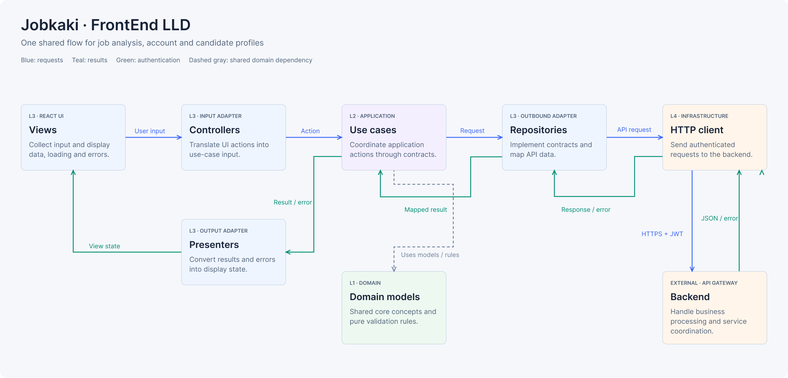
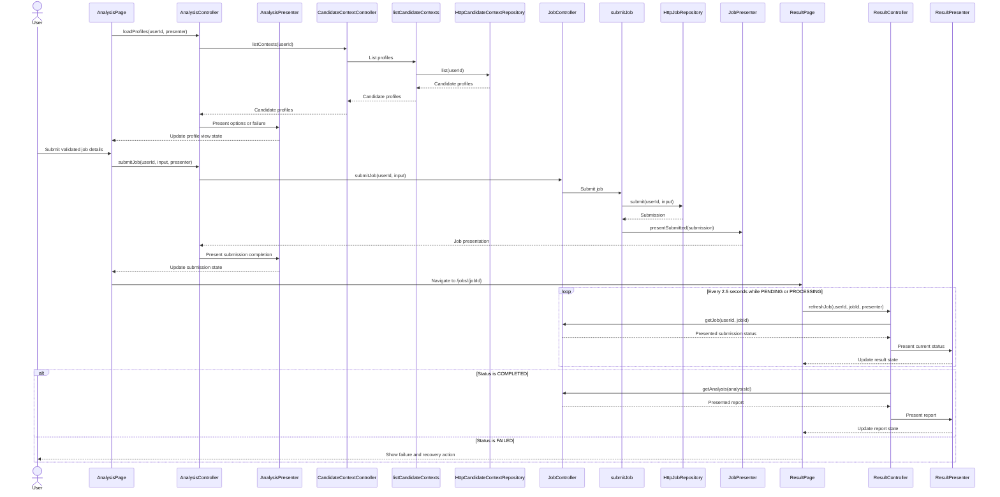

# JobKaki Frontend

## LLD



[View the LLD in Figma](https://www.figma.com/design/TlqNS7H8eS6y3poiiImCV9/Java-System-Architecture?node-id=339-170)

## Layers and responsibilities

The frontend uses application-wide Clean Architecture, organised by layer rather than feature.

| Layer                  | Directory            | Responsibility                                                                                                                                                                       |
| ---------------------- | -------------------- | ------------------------------------------------------------------------------------------------------------------------------------------------------------------------------------ |
| Entities               | `src/domain`         | Define frontend models independently of UI frameworks and external services.                                                                                                         |
| Use cases              | `src/application`    | Coordinate application operations and declare controller, repository, presenter and client contracts.                                                                                |
| Interface adapters     | `src/adapters`       | Validate input through controllers, format output through presenters, implement repositories and authentication clients, and connect React views to controllers through route props. |
| Frameworks and drivers | `src/infrastructure` | Configure Axios transport, Keycloak SDK, React Query, environment values and provider assembly.                                                                                      |

## Example flow: Job Submission



[View the sequence in Figma](https://www.figma.com/design/TlqNS7H8eS6y3poiiImCV9/Java-System-Architecture?node-id=331-170)

## Routing

Routes are defined in [`src/adapters/views/routes.tsx`](src/adapters/views/routes.tsx) using React Router.

| Route                  | Page                                  |
| ---------------------- | ------------------------------------- |
| `/login`               | Sign in                               |
| `/onboarding`          | Initial account and candidate setup   |
| `/dashboard`           | Overview and recent analyses          |
| `/analyse`             | Submit a job                          |
| `/jobs/:jobId`         | Submission status and analysis report |
| `/history`             | Job submission history                |
| `/profiles`            | Candidate profiles                    |
| `/profiles/new`        | Create a candidate profile            |
| `/profiles/:contextId` | Edit a candidate profile              |
| `/account`             | Account details                       |

- `Guard` waits for authentication and redirects signed-out users to `/login`.
- `OnboardingGate` checks the account's saved `onboardingCompleted` flag before showing the main application.
- `/onboarding` requires authentication but sits outside `OnboardingGate`.
- Unknown routes redirect to `/dashboard`, where the same access checks apply.

## Setup

Install Node.js and npm, and start the [backend and its dependencies](../Backend/README.md#setup-and-running-locally).

Configure a public Keycloak client for Authorization Code with PKCE S256, redirect URIs of `http://localhost:5173/*`, and Web Origins of `http://localhost:5173`.

Create `.env.local` in the frontend root:

```dotenv
VITE_API_BASE_URL=http://localhost:8080
VITE_KEYCLOAK_URL=http://localhost:8084
VITE_KEYCLOAK_REALM=jobkaki-oauth2
VITE_KEYCLOAK_CLIENT_ID=oauth2-pkce-client
```

This file is excluded from Git. `VITE_*` values are embedded in the browser bundle and must not contain secrets.

From the repository root:

```sh
cd Frontend
npm ci
npm run dev
```

Open the URL printed by Vite, normally `http://localhost:5173`. Restart Vite after changing environment values.
