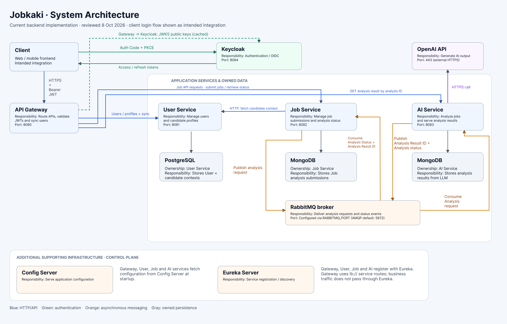

# JobKaki

JobKaki is a full-stack microservices web application built with Java, Spring Boot and React, with OpenAI integration. Candidates create a reusable profile containing their CV, target roles, work preferences and deal-breakers, then submit a job description or public LinkedIn job link for analysis. The application assesses the fit, searches online sources such as Glassdoor, and returns requirement comparisons, potential concerns and questions to clarify before applying or during an interview.

> **Note:** Running this project locally requires environment secrets that are not included in this repository. These must be configured separately before starting the application.

## Prototype Demo

> Happy flow walkthrough - signing in, creating a candidate profile, uploading a CV, submitting a job, and reviewing the analysis.

https://github.com/user-attachments/assets/f9ce5087-dded-4cd3-9087-0dff081f73dd

## System Architecture

The [system architecture in Figma](https://www.figma.com/design/TlqNS7H8eS6y3poiiImCV9/Java-System-Architecture?node-id=41-30&p=f&m=draw) is the visual reference for services and infrastructure.

For frontend design and backend service details, read the [frontend README](Frontend/README.md) and [backend README](Backend/README.md).

## Clickable Prototypes

Explore the [clickable prototypes in Figma](https://www.figma.com/design/TlqNS7H8eS6y3poiiImCV9/Java-System-Architecture?node-id=65-1683&p=f&m=draw) to walk through the planned user journeys and screen interactions.

## Personal Motivation

- Broaden my development experience beyond iOS through Java, Spring Boot, and React.
- Apply system design concepts in a practical, public project.
- Showcase my engineering work, as most of my professional projects are covered by NDAs.

## Project Context

- During my job hunt, I used ChatGPT to evaluate how well job postings matched my experience and career priorities.
- Each evaluation considered my CV, preferred roles, work preferences, and deal-breakers.

## Problem Statement

- Evaluating each new posting meant manually resubmitting the same prompt, CV, and career preferences.
- Existing tools on the market had usage limits, costs, or features I did not need.
- I needed a way to reuse this information and evaluate more jobs with less manual effort.

## Core Features

- Sign in and complete account onboarding.
- Create candidate profiles containing a CV, target roles, preferences, and red flags.
- Submit a public LinkedIn job URL or paste a job description.
- Compare concrete job requirements with evidence from the attached CV.
- Check accessible Glassdoor reviews for company and role concerns, with clear attribution and source links.
- View analysis progress, completed reports, and submission history.
- Receive actionable failure messages when the job content or CV cannot be used.

