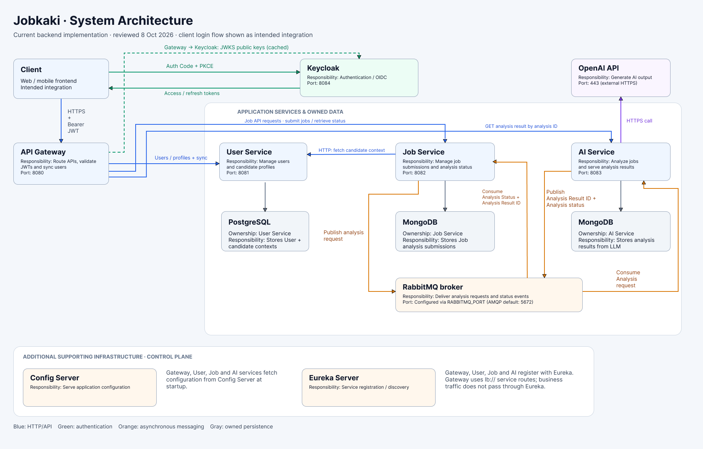

# JobKaki

## User Journey Demo

> **Video coming soon.**
>
> A walkthrough of signing in, creating a candidate profile, uploading a CV, submitting a job, and reviewing the analysis.

<!-- Replace this placeholder with the user-journey recording or a link to the video. -->

JobKaki helps candidates compare a job opportunity with their CV, target roles, work preferences, and deal-breakers. It turns a repetitive manual evaluation process into a reusable workflow, producing requirement matches, potential concerns informed by the posting and accessible Glassdoor reviews, and questions to clarify before applying.

## System Architecture

The [system architecture in Figma](https://www.figma.com/design/TlqNS7H8eS6y3poiiImCV9/Java-System-Architecture?node-id=41-30&p=f&m=draw) is the visual reference for services and infrastructure.

For low-level design and example data flows, read the [frontend README](Frontend/README.md) and [backend README](Backend/README.md).

## Clickable Prototypes

Explore the [clickable prototypes in Figma](https://www.figma.com/design/TlqNS7H8eS6y3poiiImCV9/Java-System-Architecture?node-id=65-1683&p=f&m=draw) to walk through the planned user journeys and screen interactions.

## Personal Motivation

- Broaden my development experience beyond iOS through Java, Spring Boot, and React.
- Apply system design concepts in a practical, public project.
- Showcase my engineering work, as most of my professional projects are covered by NDAs.

## Project Context

- During my job hunt, I used ChatGPT to evaluate how well job postings matched my experience and career priorities.
- Each evaluation considered my CV, preferred roles, work preferences, and deal-breakers.

## Problem Statement

- Evaluating each new posting meant manually resubmitting the same prompt, CV, and career preferences.
- Existing tools on the market had usage limits, costs, or features I did not need.
- I needed a way to reuse this information and evaluate more jobs with less manual effort.

## Core Features

- Sign in and complete account onboarding.
- Create candidate profiles containing a CV, target roles, preferences, and red flags.
- Submit a public LinkedIn job URL or paste a job description.
- Compare concrete job requirements with evidence from the attached CV.
- Check accessible Glassdoor reviews for company and role concerns, with clear attribution and source links.
- View analysis progress, completed reports, and submission history.
- Receive actionable failure messages when the job content or CV cannot be used.

## Key Architectural Decisions and Tradeoffs

| Architectural Decision | Rationale | Tradeoffs |
| --- | --- | --- |
| **Microservices with service-owned data** | • Clear ownership of users, job submissions, and AI analysis. • Flexibility to deploy and scale services independently. | • More configuration, network dependencies, and operational overhead. • A modular monolith would be simpler at this scale. |
| **Application-wide Clean Architecture frontend** | • Experiment with explicit boundaries between UI, application logic, business models, and networking. • Keep application operations independent of React, HTTP transport, and authentication SDKs. | • Additional boilerplate and learning curve. • Simple changes span multiple files. • Requires discipline around contracts and dependency wiring; some simple operations remain thin repository calls. |
| **Asynchronous analysis through RabbitMQ** | • Let users continue using the application while analysis runs in the background. • Decouple analysis requests from a specific application instance. • Support expansion into multiple AI workers sharing a workload or specialised agents consuming separate queues. • Buffer bursts of submissions when workers are busy. | • Additional infrastructure to configure and maintain. • Queue backlogs increase waiting times. • Processing capacity remains constrained by workers and external API limits. • Database writes and message publication can fail separately. |
| **Authentication delegated to Keycloak** | • Delegate login and token issuance to a dedicated identity provider. • Use Authorization Code + PKCE for browser login. • Validate JWTs at the gateway. | • Additional infrastructure and configuration. • Application users must remain aligned with identity records. • Resource ownership requires separate authorization checks. |
| **API Gateway as a single entry point** | • Give the frontend one API endpoint. • Centralise routing, token validation, and user synchronisation. • Support future scaling through multiple gateway instances behind a load balancer. | • The current single gateway instance is a potential bottleneck and single point of failure. • Gateway replication, rate limiting, and load testing remain future work. • Additional network hop. • User synchronisation couples requests to the User Service. |
| **PostgreSQL and MongoDB persistence** | • Use PostgreSQL for relational user records. • Use MongoDB for job submissions and nested analysis documents. | • Multiple database technologies to operate and maintain. • A single database technology could meet the MVP’s needs. |
| **Eureka service discovery** | • Route using service names rather than fixed instance addresses. • Support changing service locations and adding replicas. | • Additional infrastructure and discovery complexity. • Static addresses would be simpler for local deployment. |
| **Centralised configuration with Config Server** | • Manage service configuration in one place. • Reduce configuration scattered across applications. | • Introduce a startup dependency. • Configuration changes can affect multiple services. • Secret management requires separate consideration. |
